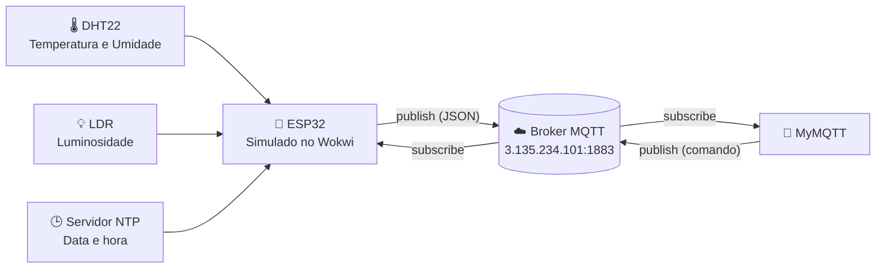

<div align="center">

# 🍷 Vinheria Agnello Inteligente

### 📡 Monitoramento Ambiental com ESP32 e MQTT


**FIAP · Edge Computing · Grupo 067**

[🔗 Simulação no Wokwi](https://wokwi.com/projects/478537713309912065) 

</div>

---

## 📖 Sobre o Projeto

Imagine uma adega onde o ambiente é monitorado o tempo todo e cada leitura chega, em tempo real, direto no celular do responsável.

É isso que este projeto simula.

A **Vinheria Agnello Inteligente** usa um **ESP32** para acompanhar os fatores mais importantes para a conservação dos vinhos e envia tudo para a nuvem por **MQTT**, a cada **5 segundos**, com data e hora de Brasília:

<div align="center">

🌡️ **Temperatura** &nbsp;&nbsp;|&nbsp;&nbsp; 💧 **Umidade** &nbsp;&nbsp;|&nbsp;&nbsp; 💡 **Luminosidade** &nbsp;&nbsp;|&nbsp;&nbsp; 🕒 **Data e hora**

</div>

E a comunicação funciona **nos dois sentidos**: o ESP32 envia os dados e também recebe comandos enviados pelo aplicativo.

---

## 🍇 Por que monitorar?

| Fator | Faixa ideal no sistema | Por que importa |
|:---:|:---:|---|
| 🌡️ Temperatura | **10 °C a 16 °C** | Calor acelera o envelhecimento e pode estragar o vinho; frio excessivo também prejudica. |
| 💧 Umidade | **60% a 80%** | Ar seco resseca a rolha e deixa o oxigênio entrar; umidade excessiva favorece mofo. |
| 💡 Luz | Quanto menor, melhor | A exposição à luz degrada compostos do vinho e altera aroma e sabor. |

Fora dessas faixas, o ESP32 exibe alertas no Serial Monitor:

```
ALERTA: Temperatura elevada!     → acima de 16 °C
ALERTA: Temperatura baixa!       → abaixo de 10 °C
ALERTA: Umidade inadequada!      → abaixo de 60% ou acima de 80%
```

---

## 🏗️ Arquitetura



| Fluxo | Como funciona |
|---|---|
| 📤 **ESP32 → App** | A cada 5 segundos, o ESP32 lê os sensores, monta um JSON com data e hora e publica no tópico de dados. O MyMQTT, inscrito nesse tópico, exibe as leituras. |
| 📥 **App → ESP32** | O MyMQTT publica um texto no tópico de comandos. O ESP32, inscrito nele, recebe a mensagem e a exibe no Serial Monitor. |

---

## 🧰 Componentes

<div align="center">

| Componente | Função |
|:---:|---|
| 🔌 **ESP32 DevKit C v4** | Executa o código, conecta ao Wi-Fi e se comunica com o broker MQTT |
| 🌡️ **DHT22** | Mede temperatura (°C) e umidade relativa do ar (%) |
| 💡 **LDR** | Mede a luminosidade; o ESP32 converte o sinal analógico em valor ADC (0 a 4095) |

</div>

### 🔧 Ligações

| Componente | Sinal | Pino do ESP32 |
|:---:|:---:|:---:|
| DHT22 | DATA | `GPIO 15` |
| LDR | Saída analógica (AO) | `GPIO 34` |

---

## 📡 Comunicação MQTT

### ⚙️ Broker

| Campo | Valor |
|---|---|
| 🌐 Host | `3.135.234.101` |
| 🚪 Porta | `1883` |
| 🧩 Versão | MQTT 3.1.1 |
| 🔒 SSL/TLS | Desativado |
| 📶 Wi-Fi (Wokwi) | `Wokwi-GUEST` |

### 🏷️ Tópicos

| Direção | Tópico | Uso |
|:---:|---|---|
| 📤 ESP32 publica | `vinheria/agnello/cp05/grupo067/dados` | Leituras dos sensores |
| 📥 ESP32 assina | `vinheria/agnello/cp05/grupo067/comandos` | Comandos recebidos |

### 📦 Formato das mensagens

**Leituras publicadas pelo ESP32** (exemplo)

```json
{
  "temperatura": 13.5,
  "umidade": 70.0,
  "luminosidade": 1520,
  "timestamp": "2026-10-23T14:30:00-03:00"
}
```

| Campo | Tipo | Descrição |
|---|:---:|---|
| `temperatura` | número | Temperatura em °C, com 1 casa decimal |
| `umidade` | número | Umidade relativa em %, com 1 casa decimal |
| `luminosidade` | inteiro | Leitura ADC do LDR |
| `timestamp` | texto | Data e hora de Brasília (UTC-3), obtida via NTP |

**Comandos recebidos pelo ESP32**

Qualquer texto publicado no tópico de comandos é recebido e exibido no Serial Monitor:

```
===== COMANDO MQTT =====
Topico: vinheria/agnello/cp05/grupo067/comandos
Comando recebido: teste de comando
========================
```

---

## 🚀 Como Executar

### 1️⃣ Simulação no Wokwi

1. Abra o [projeto no Wokwi](https://wokwi.com/projects/478537713309912065).
2. Clique em ▶️ **Start the simulation**.
3. Acompanhe pelo **Serial Monitor**: conexão Wi-Fi, sincronização NTP e conexão ao broker.
4. Clique no DHT22 e no LDR para alterar os valores durante a simulação.

### 2️⃣ Aplicativo MyMQTT

1. Abra o **MyMQTT** e vá em **Settings**.
2. Configure host `3.135.234.101`, porta `1883`, MQTT 3.1.1 e SSL/TLS desativado.
3. Toque em **Connect**.
4. Em **Subscribe**, assine `vinheria/agnello/cp05/grupo067/dados` para ver as leituras.
5. Em **Publish**, envie um texto para `vinheria/agnello/cp05/grupo067/comandos` e confira no Serial Monitor do Wokwi.

---

## ✅ Testes Realizados

| Teste | Resultado esperado | Status |
|---|---|:---:|
| Conexão Wi-Fi | `Wi-Fi conectado!` e IP local no Serial Monitor | ✅ |
| Sincronização NTP | `Horario sincronizado!` no Serial Monitor | ✅ |
| Conexão ao broker | `CONECTADO!` e inscrição no tópico de comandos | ✅ |
| ESP32 → MyMQTT | JSON com temperatura, umidade, luminosidade e timestamp aparece no app | ✅ |
| MyMQTT → ESP32 | Comando enviado aparece no Serial Monitor | ✅ |
| Alertas | Mensagens de alerta ao sair das faixas de temperatura e umidade | ✅ |

---

## 📂 Estrutura do Projeto

```
📁 vinheria-agnello
├── 📄 README.md
├── 💻 sketch.ino       # código do ESP32
├── 🔌 diagram.json     # circuito do Wokwi
└── 📚 libraries.txt    # bibliotecas utilizadas
```

---

## 📚 Bibliotecas


---

## 👥 Integrantes

<div align="center">

| 👤 Nome | 🎓 RM |
|---|:---:|
| Erick Ripari Gomes | RM569441 |
| Guilherme Gimenez | RM563389 |
| Fabricio Denig | RM570980 |

</div>

---

<div align="center">

🍷 *Vinheria Agnello Inteligente: tecnologia a serviço da tradição.*

**FIAP · Edge Computing · 2026**

</div>
